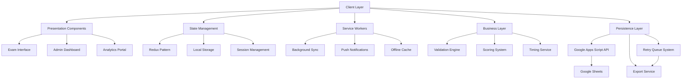

# 🕶️ Ta3leamFanyExam  
 for Egyptian Ministry of Education and Technical Education*  
## 🌍 Live App


<p align="center">
  <a href="https://incomparable-empanada-ebe133.netlify.app/" target="_blank">
    🚀 <b>Click here to launch the app</b> 🌍
  </a>
</p>

<p align="center">
  
  
  
  
</p>

<p align="center">
  
</p>

---

## ⚡ Overview
Ta3leamFanyExam is a **client-side exam platform** built for schools that want **timed digital tests** without expensive infrastructure.  
It uses  a backend database, supports **offline retries**, and is designed with a **RTL Arabic UI** for students and teachers.

Think of it as **HackerRank meets Google Sheets** — minimal, secure, and hacker-friendly. 🕶️  

---

## ✨ Features
✅ Full **Arabic RTL** interface (Bootstrap 4)  
✅ **Timed exam** with auto-submit ⏳  
✅ Randomized questions & per-subject weighting 🎲  
✅ **Validation** for school codes, student data & answers 🔒  
✅ Results stored in **Google Sheets** via Apps Script ☁️  
✅ Offline **retry queue** (localStorage) 🔁  
✅ GET + POST request handling (with fallback) 🔌  


---

## 🛠️ Tech Stack
- **Frontend** → HTML, CSS, JS, jQuery, Bootstrap 4  
- **Backend** → Google Apps Script (Web App)  
- **Storage** → Google Sheets  

---

## 📂 Project Structure



---

## 🚀 Quick Start  

### 📌 Prerequisites
- Google account + Google Sheet access  
- Modern browser (Chrome / Firefox)  
- Optional: static server (VSCode Live Server / Python)  

### ⚙️ Run Locally
```bash
python3 -m http.server 8000
```
--- 
🔗 Google Sheets Setup

Create a new Google Sheet with this header row:

Timestamp | School | Student Name | Class | Score | Percentage | Status | Answers


Open Extensions → Apps Script and paste in the provided doPost / doGet script.

Run setup() once to store Spreadsheet ID.

Deploy as Web App →

Execute as: Me

Who has access: Anyone, even anonymous

Copy the deployment URL.

development process be like
---
<p align="center">
  
</p>

